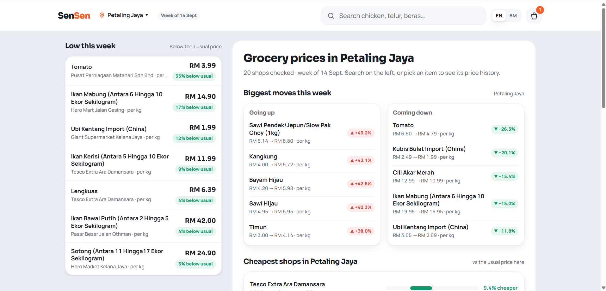
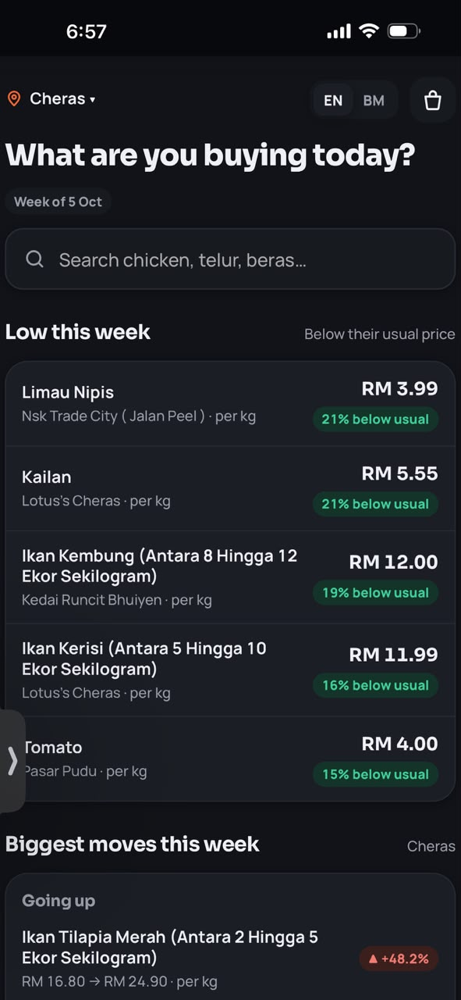
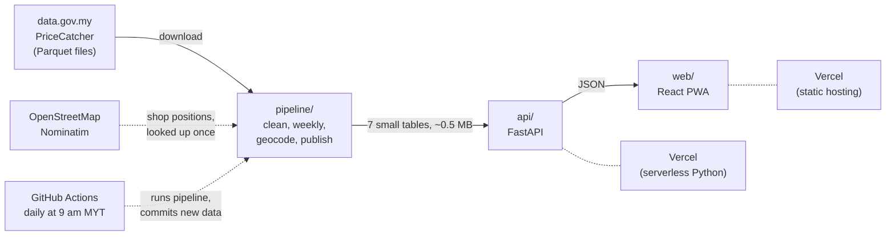

# SenSen

**Grocery prices near you, for Selangor, Kuala Lumpur and Putrajaya.**
Find the cheapest shop for an item, see if today's price is low or high compared to usual, and work out which shop is cheapest for your whole basket.

**Live app:** https://sensen-xi.vercel.app

**Status:** beta (v0.7.0). Free to use, no account, no ads.

<!-- Add your own screenshots to docs/screenshots/ with these names -->
<p>
  
  
</p>

## Why SenSen

Grocery prices in Malaysia keep going up, and it is hard to tell whether a shop is charging a fair price or just more than everyone else. SenSen pushes back against overpricing with transparency: it shows what an item usually costs, which shops nearby are cheaper, and when a price is higher than normal. Every number comes from the government's own PriceCatcher data, so shoppers can decide where to spend with facts instead of guesses.

---

## What it does

- **Cheapest shop per item.** Search in English or BM ("chicken" or "ayam") and see which shops in your area have the lowest recent price. Every item PriceCatcher lists can be found, and the app says clearly when one has no recent price.
- **Cheapest near you.** Turn on location and see the cheapest shops within 3, 5 or 10 km, with a link to each shop on Google Maps. Distances are worked out on your phone; your location is never sent anywhere.
- **Your area, automatically.** Tap "Use my location" and SenSen picks your area for you, and follows you when you move. You can also type your neighbourhood ("Ampang", "Cyberjaya") to find it.
- **Low, Normal or High.** Each item gets a label that compares this week's price with its own last 6 months, so you know if it is a good week to buy.
- **Basket comparison.** Add up to 30 items with quantities (2 kg chicken, 3 packs of milk) and see which single shop is cheapest for all of them, plus how much you would save by splitting the trip.
- **Budget planner.** Tap **Start budgeting** in the basket (even an empty one), pick the shop you'll go to (nearest first if location is on), set a budget and press Start plan. You then see everything that shop sells, by category, with a hint when a shop nearby sells an item for less ("Cheaper at Lotus's: RM 8.90 · 1.2 km"). Add items and see what's left as you change quantities. In the shop, tick items off as they go in the trolley to see what you've spent so far. Once the plan is started, the budget floats on screen while you browse (a card on a laptop, a bar above the tabs on a phone) and updates as you add items. End plan clears it and keeps your basket. Saved on your phone only.
- **Weekly overview.** Items that are cheaper than usual this week, the biggest price moves, and which shops are cheapest overall in your area.
- **Works like an app.** Install it to your home screen, use it in English or Bahasa Melayu, and it still shows your last loaded prices when you are offline. It updates itself when a new version is released.
- **Refreshes itself.** New government price data is picked up every morning, with no manual work.

## Install it on your phone

SenSen is a Progressive Web App (PWA), so there is no app store. Open **https://sensen-xi.vercel.app**, then:

| Device | Steps |
|---|---|
| **iPhone / iPad** (Safari) | Tap **Share**, then **Add to Home Screen** |
| **Android** (Chrome) | Tap the **⋮** menu, then **Install app** (or **Add to Home screen**) |
| **Laptop** (Chrome / Edge / Brave) | Click the **install icon** at the right of the address bar |

It then opens in its own window with the SenSen icon, like any other app.

---

## How it works



1. **Data.** [PriceCatcher](https://data.gov.my/data-catalogue/pricecatcher) is open data from KPDN: prices of hundreds of everyday items, checked in person by officers at shops all over Malaysia. It is published as monthly Parquet files.
2. **Pipeline (Python, pandas).** Downloads the last 6 full months plus the current month, keeps grocery shops in Selangor, KL and Putrajaya, removes obvious data errors, and builds weekly prices, labels, price moves and shop rankings. It also finds each shop's position and neighbourhood name on the map with OpenStreetMap, once per shop. The API only needs 7 small tables (about 0.5 MB), which are copied into `api/data/`.
3. **API (FastAPI).** Loads those tables into memory once at start-up and answers every request from memory. Endpoints: `/areas`, `/items/search`, `/items/{code}`, `/items/{code}/prices`, `/categories`, `/browse`, `/shops`, `/shops/{code}/items`, `/stores`, `/movers`, `/deals`, `/basket`. Interactive docs: https://sensen-api.vercel.app/docs
4. **Web app (React + Vite).** A PWA with a phone layout and a separate laptop layout (a two-column dashboard, not a stretched phone screen). For "near me" it downloads every shop's price and position for one item, then works out distances on the device.
5. **Automation.** A GitHub Action runs the pipeline every morning, runs the tests, and commits the new data only if it changed. That commit makes Vercel redeploy the API.

### How the numbers are decided

| Rule | Detail |
|---|---|
| Coverage | Selangor, Kuala Lumpur and Putrajaya, grocery shop types only (cooked food is excluded) |
| Data errors | A reading more than 3 times away from the item's median is dropped |
| Weekly price | Median price per shop, then the median across shops. Only complete Monday to Sunday weeks are used |
| Low / Normal / High | This week vs the item's last 26 weeks: below the 25th percentile is Low, above the 75th is High. Needs at least 8 weeks of history and 3 shops |
| "Fresh" price | Within 14 days of the newest date in the data |
| Price moves | Only items with 3 or more shops in both weeks |
| Cheapest shops | Each shop's prices compared to the area's typical price (needs at least 10 items) |
| Basket | Each price is multiplied by its quantity. Shops that have every item come first, so a shop that is cheaper only because it is missing items does not win. In the budget planner, an item your shop has no price for is counted at the cheapest price elsewhere and marked ~ |
| Shop positions | Searched from exact to rough (address, building, street, postcode, town). A shop placed far from the other shops in its own district is searched again inside that district, and marked approximate (~) if only a rough spot is found |
| Areas | PriceCatcher's districts. Each one is labelled with the neighbourhoods its shops are in (OpenStreetMap's name for each shop's spot, e.g. Kota Damansara), so typing "Ampang" or "Cyberjaya" finds the right district. "Use my location" picks the district of the 5 shops nearest you, worked out on your phone |

---

## Tech stack

| Part | Tools |
|---|---|
| Data pipeline | Python 3.13, pandas, PyArrow (Parquet) |
| API | FastAPI, Pydantic response models, pytest |
| Web app | React 19, Vite 8, vite-plugin-pwa (Workbox service worker), plain CSS |
| Hosting | Vercel Hobby (web app as static files, API as a serverless Python function) |
| Maps | OpenStreetMap Nominatim (shop positions, cached), Google Maps links (no API key) |
| Automation | GitHub Actions (daily data refresh) |
| Cost | RM 0: free tiers only, no card on file |

Some choices I made on purpose:

- **No database.** The data changes once a day and is about 0.5 MB, so the API keeps it in memory. That is faster and simpler than running a database, and it costs nothing.
- **No chart or UI libraries.** The price chart is a hand-drawn SVG, and the area picker is a custom component, because a normal dropdown cannot grey out part of an option. This keeps the app small and fast on a phone.
- **Your location stays on your phone.** The app asks the server for every shop's price for an item and works out the distances itself (the haversine formula), so no one's location is ever sent or stored.
- **Offline first.** The service worker serves the app shell from the cache, and API answers use "network first, then cache", so prices stay fresh online and still show when offline.
- **Two languages without a library.** All text lives in one file (`web/src/i18n.jsx`), so adding a word in English and BM happens in one place.

---

## Project structure

```
sensen/
├── .github/workflows/
│   └── refresh-prices.yml   daily: run pipeline, test, commit new data
├── api/                     the FastAPI app (deployed on its own)
│   ├── main.py
│   ├── requirements.txt
│   └── data/                7 tables made by the pipeline
├── pipeline/
│   ├── download.py          get PriceCatcher files from data.gov.my
│   ├── clean.py             filter to Selangor, KL and Putrajaya grocery shops, drop errors
│   ├── weekly.py            weekly prices, labels and price moves
│   ├── geocode.py           shop positions and neighbourhoods from OpenStreetMap
│   ├── geocache.csv         saved positions, so each shop is looked up only once
│   ├── publish.py           search index, latest prices, areas, towns and shops
│   ├── ship.py              copy the API's tables into api/data
│   └── run.py               run all the steps in order
├── tests/
│   └── test_api.py          API tests on the real data
└── web/                     the React PWA
    ├── src/
    │   ├── components/      Header, AreaPicker, Results, ItemDetail, Basket, ...
    │   ├── api.js           every call to the API
    │   ├── geo.js           distances and map links for "near me"
    │   ├── LocationContext.jsx  the phone's location, kept in memory only
    │   ├── i18n.jsx         English and BM text
    │   └── hooks.js         data loading, routing, screen size, online status
    └── vite.config.js       build settings and PWA setup
```

---

## For developers: run it locally

> **Just want to use SenSen?** You don't need any of this. Open https://sensen-xi.vercel.app and install it from there.

This is only for working on the code. You need **Python 3.13** and **Node.js 24**.

**1. Data and API**

```bash
git clone https://github.com/HazzyWan/sensen.git
cd sensen

python -m venv .venv
# Windows:      .venv\Scripts\activate
# macOS/Linux:  source .venv/bin/activate
pip install -r requirements-dev.txt

python pipeline/run.py        # downloads about 7 months of data, takes a few minutes
python -m pytest              # checks the API against the data
fastapi dev api/main.py       # API on http://127.0.0.1:8000 (docs at /docs)
```

**2. Web app** (in a second terminal)

```bash
cd web
npm install
npm run dev                   # app on http://localhost:5173
```

The web app talks to `http://127.0.0.1:8000` by default. To point it somewhere else, set `VITE_API_URL`.

---

## Roadmap

- [x] M0 to M2: data pipeline, API, web app (search, item detail, basket, overview)
- [x] M3: installable PWA, offline support, English and BM
- [x] M4: live on Vercel with a daily automatic refresh
- [x] v0.5: cheapest shops near you (location stays on your phone), self-updating app
- [x] v0.6: browse by category, new home screen, bottom tab bar on phone, area picked from your location
- [x] v0.7: budget planner (pick one shop, set a budget, quantities, tick items off while shopping)
- [ ] v0.8: scan an item with the camera to find it (visual search)
- [ ] v0.9: community prices for items PriceCatcher doesn't cover
- [ ] v1.0: SenSen assistant, an AI chat that answers from real prices
- [ ] v1.1: a SenSen mascot and a first-run tour that highlights each button and tab and explains it

---

## Data and credits

Prices come from **PriceCatcher** by the Ministry of Domestic Trade and Cost of Living (KPDN), published on [data.gov.my](https://data.gov.my/data-catalogue/pricecatcher) with DOSM under the **CC BY 4.0** licence. SenSen is an independent project and is not connected to KPDN or DOSM. Prices are reported with a delay of about two weeks, so always check the shelf price.

Shop positions come from [OpenStreetMap](https://www.openstreetmap.org/copyright) (© OpenStreetMap contributors, ODbL), found with the Nominatim service.

The code is under the licence in [LICENSE](LICENSE).

---

Built by **Hazwan** · [LinkedIn](https://www.linkedin.com/in/hazwan-syauqee) · [Portfolio](https://hazzywan.github.io/)